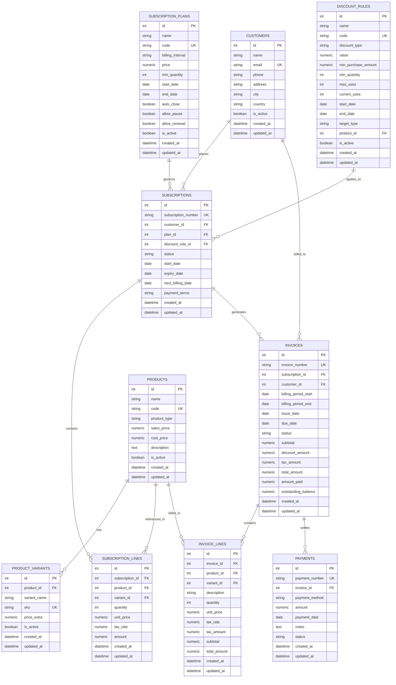

# Pay-Doo — Brightloop Subscription Management System

Enterprise-grade subscription, billing, and recurring revenue engine built for **Brightloop Software** (Odoo Hackathon 2026).

---

## 1. Architecture Overview

- **Backend Framework:** FastAPI (Python 3.12)
- **Data Persistence:** SQLAlchemy 2.0 ORM with PostgreSQL / SQLite support
- **Data Validation:** Pydantic v2 schemas at all system boundaries
- **Financial Precision:** Currency stored as `NUMERIC(12, 2)` / Python `Decimal` with deterministic rounding
- **Idempotent Billing:** Database-level unique constraint preventing duplicate invoices per subscription billing cycle

---

## 2. Entity-Relationship Diagram (ERD)



---

## 3. Core Business Workflow

```
Customer Registration
       ↓
Plan & Product Selection (with Variants)
       ↓
Subscription Creation (Draft → Confirmed → Active)
       ↓
Automated Billing Engine (Period-specific Invoice Generation)
       ↓
Payment Recording & Partial/Full Settlement
       ↓
Dynamic Real-Time KPI Telemetry Dashboard
```

---

## 4. Quickstart Guide (Backend)

### Prerequisites
- Python 3.12+
- Docker (optional for PostgreSQL container)

### Step 1: Environment Setup
```bash
cd backend
python -m venv .venv
# Windows:
.venv\Scripts\activate
# Linux/macOS:
source .venv/bin/activate

pip install -r requirements.txt
```

### Step 2: Seed Initial Data
```bash
python -m app.seed
```

### Step 3: Run the API Server
```bash
python run.py
```
- API Base URL: `http://localhost:8000/api`
- Interactive Swagger UI: `http://localhost:8000/docs`
- ReDoc: `http://localhost:8000/redoc`

### Step 4: Run Test Suite
```bash
pytest -v
```

---

## 5. API Contract Reference
For endpoint specifications, request/response payloads, and error schemas, see [`docs/API_CONTRACT.md`](docs/API_CONTRACT.md).

