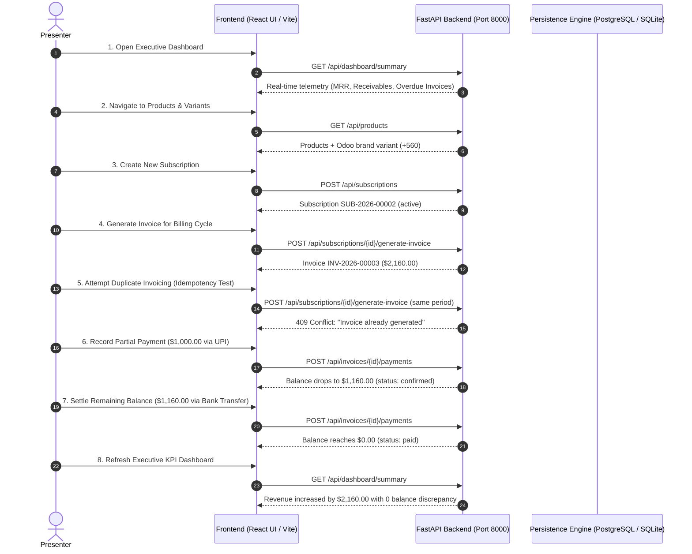

# Pay-Doo — Live Hackathon Demonstration Runbook
**Role:** Release Verification Owner & Senior QA Engineer (Laptop 3)  
**System:** Brightloop Subscription Management System (Pay-Doo)  
**Target Audience:** Hackathon Judges, Product Owners, Engineering Leads  
**Estimated Demo Duration:** 5 - 7 minutes  

---

## 1. System Startup & Verification

### Step 1: Database Startup
**Option A: PostgreSQL via Docker Compose (Default Production Target)**
```bash
docker compose up -d
docker compose ps
# Expected: brightloop_postgres running on 0.0.0.0:5432
```

**Option B: SQLite Local Execution (Zero-Dependency Fallback)**
In `backend/.env`:
```env
APP_NAME="Brightloop Subscription Management System"
DATABASE_URL="sqlite:///./brightloop.db"
API_V1_PREFIX="/api"
DEBUG=false
```

### Step 2: Seed the Database
Populate standard demonstration fixtures (customers, products with variants, plans, discounts, subscriptions, historical invoices):
```bash
cd backend
python -m app.seed
```

### Step 3: Launch Backend API Server
```bash
cd backend
python run.py
```
- API Base: `http://localhost:8000/api`
- Interactive Swagger UI: `http://localhost:8000/docs`
- Health check: `http://localhost:8000/api/health`

### Step 4: Launch Frontend Application
```bash
cd frontend
npm install
npm run dev
```
- Web Application URL: `http://localhost:5173`

---

## 2. Step-by-Step Live Demonstration Script



### Demonstration Narrative:
1. **Executive Telemetry:** Start on `/` (Dashboard). Point out active subscriptions count, realized revenue, outstanding receivables, and overdue invoices calculated live from transactions.
2. **Catalog & Plan Flexibility:** Show products, highlighting the variant system (e.g. Odoo brand addition of $+560$). Show plans with configurable intervals (daily, weekly, monthly, yearly) and pause policies.
3. **Subscription Lifecycle:** Create a new subscription for customer Nexus Infotech. Verify its transition into `active` state with computed next-billing date.
4. **Automated Billing Engine:** Open subscription details and click **"Generate Invoice"** for billing cycle `2026-11-01` to `2026-11-30`. The system calculates subtotal, discounts, 18% GST, and initial outstanding balance.
5. **The Idempotency Judge Test:** Immediately click **"Generate Invoice"** a second time for the exact same billing cycle. The application blocks the duplicate request with **HTTP 409 Conflict**:
   `"Invoice already generated for subscription X and period 2026-11-01 to 2026-11-30."`
   *Emphasize that this is protected both in the application transaction and by a database unique constraint (`uq_subscription_billing_period`).*
6. **Payment Settlement & Reconciliation:**
   - Record partial payment of `$1,000.00` via UPI. Show that invoice status stays `confirmed` and outstanding balance drops to `$1,160.00`.
   - Settle the remaining `$1,160.00` via Bank Transfer. Show outstanding balance drops to `$0.00` and status transitions to `paid`.
   - Demonstrate overpayment guard: attempt to pay `$10.00` on the settled invoice. The system rejects with `"Invoice is already fully paid."`
7. **Instant Financial Realization:** Return to Dashboard. The `$2,160.00` is immediately added to realized revenue, and receivables reconcile with penny-level accuracy.

---

## 3. Pre-Demo Health Check Command
Run the test suite in 1 second to ensure complete system readiness:
```bash
cd backend
pytest -v
# Expected: 14 passed in ~1.00s
```
