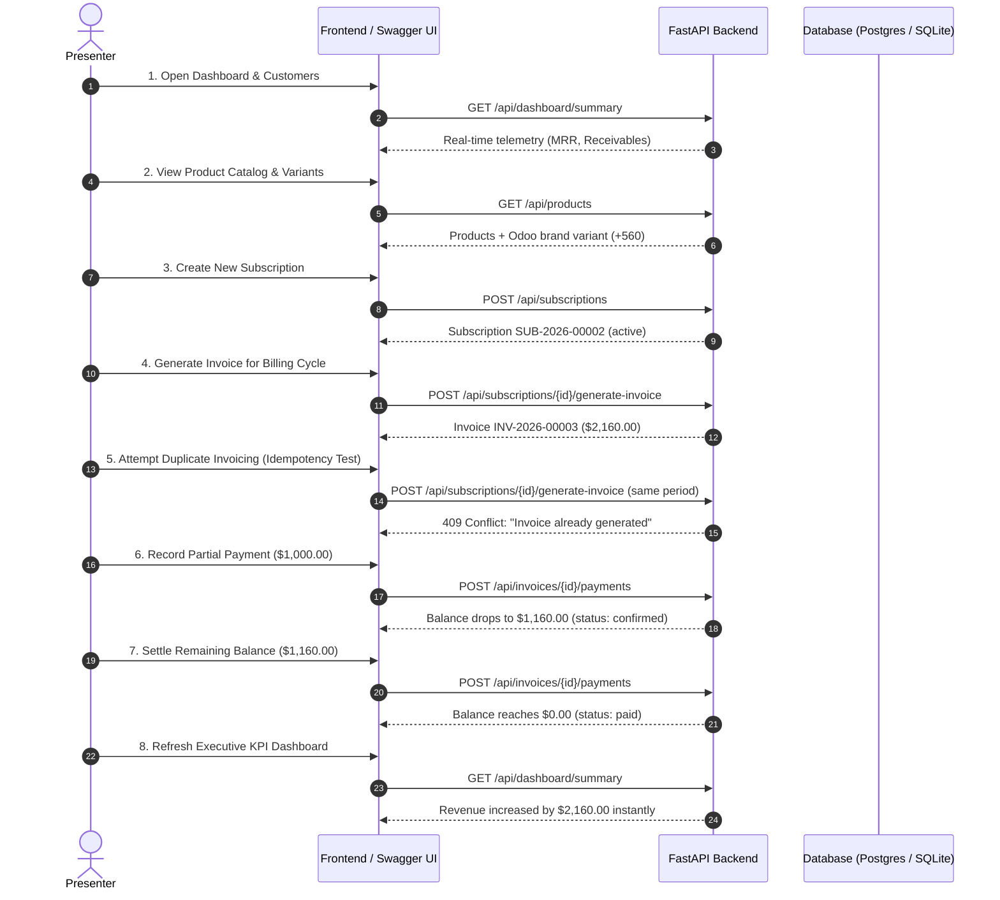

# Pay-Doo — Live Hackathon Demonstration Runbook
**Role:** Release Verification Owner & Senior QA Engineer (Laptop 3)  
**System:** Brightloop Subscription Management System (Pay-Doo)  
**Target Audience:** Hackathon Judges, Product Owners, Engineering Leads  
**Estimated Demo Duration:** 5 - 7 minutes  

---

## 1. System Startup & Verification

### Step 1: Environment Configuration
In `backend/`, ensure `.env` is configured.

**Option A: PostgreSQL via Docker Compose (Default Production Target)**
```bash
docker compose up -d
```
Verify container:
```bash
docker compose ps
# Expected: brightloop_postgres running on 0.0.0.0:5432
```

**Option B: SQLite Local Execution (Zero-Dependency Fallback)**
In `backend/.env`:
```env
APP_NAME="Brightloop Subscription Management System"
DATABASE_URL="sqlite:///./brightloop.db"
API_V1_PREFIX="/api"
DEBUG=false
```

### Step 2: Seed the Database
Populate standard demonstration fixtures (customers, products with variants, plans, discounts, subscriptions):
```bash
cd backend
python -m app.seed
```

### Step 3: Launch Backend Server
```bash
python run.py
```
- API Base: `http://localhost:8000/api`
- Swagger UI: `http://localhost:8000/docs`
- Health check: `http://localhost:8000/api/health`

---

## 2. Step-by-Step Live Demonstration Script



### Step 1: Real-Time Executive Dashboard
- **Action:** Navigate to Dashboard (`/` or `GET /api/dashboard/summary`).
- **Talking Point:** *"Pay-Doo replaces Brightloop's manual spreadsheets with real-time financial telemetry. Every metric—active subscriptions, recognized revenue, and overdue invoices—is calculated live from persisted transactions."*

### Step 2: Catalog & Product Variants
- **Action:** Open Products & Plans catalog (`GET /api/products`).
- **Talking Point:** *"Notice the product 'Brightloop ERP Core' with variant 'Brand: Odoo Integration' carrying a price extra of +$560. Plans feature custom billing intervals (monthly, yearly) and strict pause/renewal governance."*

### Step 3: Create a Subscription
- **Action:** Create a subscription for customer Nexus Infotech with plan `PLAN-BIZ-M` and the Odoo variant line.
- **Talking Point:** *"The subscription transitions into `active` state with automated next-billing-date tracking and line-item tax calculation."*

### Step 4: Run Automated Invoicing
- **Action:** Trigger invoice generation for the billing period `2026-11-01` to `2026-11-30`.
- **Talking Point:** *"The billing engine generates invoice `INV-2026-XXXXX`. It computes subtotal, applies qualifying discount rules, calculates 18% GST, and establishes the initial outstanding balance."*

### Step 5: Demonstrate Duplicate Billing Prevention (The Key Hackathon Test)
- **Action:** Click "Generate Invoice" a second time for the exact same billing period.
- **Expected Result:** The system immediately blocks the request with **HTTP 409 Conflict**:
  `"Invoice already generated for subscription X and period 2026-11-01 to 2026-11-30."`
- **Talking Point:** *"Judges, observe that Pay-Doo guarantees financial idempotency. Neither double clicks nor automated scheduler retries can double-bill Brightloop's clients. This is enforced both at the application service boundary and by a database unique constraint."*

### Step 6: Payment Recording & Reconciliation
- **Action A (Partial Payment):** Record payment of `$1,000.00` via UPI.
  - Show invoice status remains `"confirmed"` with outstanding balance updated in real time.
- **Action B (Settlement):** Record final settlement of `$1,160.00` via Bank Transfer.
  - Show outstanding balance drops to `$0.00` and invoice status transitions automatically to `"paid"`.
- **Action C (Overpayment Rejection):** Attempt to record `$10.00` on the paid invoice.
  - System rejects with `"Invoice is already fully paid."`

### Step 7: Executive Dashboard Telemetry Update
- **Action:** Return to `/api/dashboard/summary`.
- **Talking Point:** *"Instantly, total revenue collected reflects the newly settled funds, and receivables reconcile with zero discrepancy."*

---

## 3. Fallback / Troubleshooting Guide
- If Docker daemon is unavailable on the presentation machine, execute backend in SQLite mode (`DATABASE_URL="sqlite:///./brightloop.db"` in `.env`). Full functionality is preserved with zero code changes.
- To re-verify all 14 end-to-end tests live in 1 second before the presentation:
  ```bash
  pytest -v
  ```
